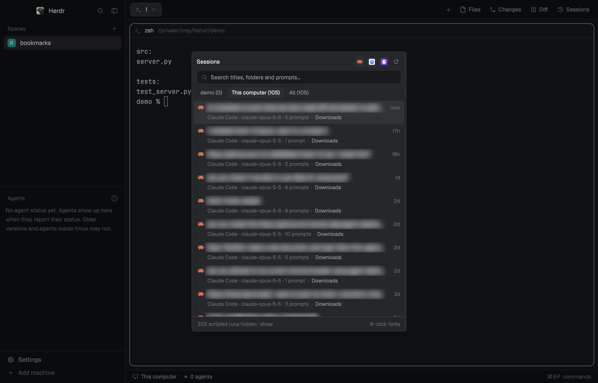

# herdr-mods

Two personal mods for the [Herdr](https://herdr.dev) app, plus an installer that adds them to a stock Herdr:

- **Diff** (`mods/session-diff`): shows what an agent changed in any folder, including folders that aren't git repos. It
  compares against snapshot baselines and has syntax highlighting, a side-by-side view and a baseline history.
- **Sessions** (`mods/sessions`): lists Claude Code, Codex and Kiro sessions on every machine Herdr knows. You can
  resume, fork or delete them.


## Using Diff

Diff shows the folder of the focused terminal. The first time it sees a folder, it saves a baseline, and every change
made after that shows up. **New baseline** starts a fresh comparison, and the `since …` menu switches to an older baseline
or deletes one.

**As a side panel:** click **Diff** in the tab bar, top right. Click it again to hide the panel. It stays next to your
terminals and updates as files change. Drag the panel's edge to make it wider; from about 760px it shows the file list and
the diff side by side, as the dialog does.


**As a separate dialog:** press `cmd-shift-g` (`ctrl-shift-g` on Linux) to open Diff as a large window over everything.
Press it again, press `Esc` or click `×` to close it.

Inside Diff:
- Pick a file in the list, or **All changes**. **Diff**, **Before** and **After** choose what's shown, and the grid
  button next to them switches between unified and side-by-side.
- `cmd-c` copies the selection, `cmd-shift-c` copies the patch, and `cmd-a` selects all.
- Drag to select text, double-click to select a word, and triple-click to select a line.

From a script or an agent:

```sh
herdr-app do layout.select --stack panel-body --child session-diff && herdr-app do layout.show --id panel  # side panel
herdr-app do layout.hide --id panel                                                                        # hide it
herdr-app do mod.open '{"name":"session-diff"}'                                                            # dialog (again: close)
```

## Using Sessions

Click **Sessions** in the tab bar to open it as a side panel, or press `cmd-shift-s` (`ctrl-shift-s` on Linux) to open
it as a popup. The tabs choose the scope: the current folder, this computer, or all machines. Click a session to
resume it in a new tab, or shift-click to fork it. Hover a session for its delete button.



## Install

Requires Herdr 0.1.10 or newer (started at least once) and `python3`.

```sh
git clone https://github.com/vinaytiparadi/herdr-mods.git ~/herdr-mods   # gh repo clone vinaytiparadi/herdr-mods works too
~/herdr-mods/install.sh
```

What `install.sh` does, under `~/.config/herdr-app` (or `$HERDR_APP_HOME`):

1. Copies `mods/session-diff` and `mods/sessions` into `mods/`. Copies already there are moved to
   `~/.cache/herdr-mods-backup/<time>/`.
2. Runs `mods/sessions/install.py`. Herdr's shipped layouts and mods are read-only, so this builds:
   - `mods/my-tabs`: a copy of this Herdr version's `tabs` mod, with Diff and Sessions buttons after Changes.
   - `layouts/my-herdr.json`: a copy of the `main` layout that uses `my-tabs` and has both panels in the side panel.
   - Key bindings in `keys.json`, added only where the key is free: `cmd-shift-s` (Sessions), `cmd-shift-g` (Diff
     dialog) and the copy keys inside Diff.
3. Switches the window to the `my-herdr` layout the first time.

If a new Herdr's tab bar no longer fits the edits, `install.py` changes nothing, says why, and exits 1.

## Herdr updates

Nothing to do. The first time a new Herdr version starts, `my-tabs` notices that its `cloned_from.version` is out of
date and re-runs `install.py`. If that fails you get a warning toast, and the old copies keep working.

## Notes for agents

- The mods run inside the Herdr app on the Mac. Remote machines need nothing installed; the scripts (`snapshot.sh`,
  `baseline.py`, `scan.py`) are sent over with Herdr's `exec(…, {on: machine})`. `scan.py` must stay Python
  3.9-compatible.
- Check a mod after an edit with `HERDR_APP_HOME=~/.config/herdr-app herdr-app check ~/.config/herdr-app/mods/<mod>`.
  It takes one mod folder, not the app home. Saving a file in a mod folder reloads that mod.
- `gpui-kit.d.ts` and `jsconfig.json` are generated by Herdr and gitignored.
- Internal ids stay `session-diff` (commands `session-diff.*`, the layout block, the cache dir) even though the UI says "Diff".

## Publishing local edits back to this repo

The live copies are in `~/.config/herdr-app/mods/`. To push changes made there:

```sh
cd ~/herdr-mods
rsync -a --delete --exclude gpui-kit.d.ts --exclude jsconfig.json \
  ~/.config/herdr-app/mods/session-diff ~/.config/herdr-app/mods/sessions mods/
git add -A && git commit -m "..." && git push
```

## Uninstall

```sh
herdr-app do layout.switch '{"name":"main"}'
rm -rf ~/.config/herdr-app/mods/{session-diff,sessions,my-tabs} ~/.config/herdr-app/layouts/my-herdr.json
```

Then remove the `mod.open:sessions` key and the `mod:session-diff` section from `~/.config/herdr-app/keys.json`.
Baseline and index caches live in `~/.cache/herdr-session-diff` and `~/.cache/herdr-sessions` on each machine.
