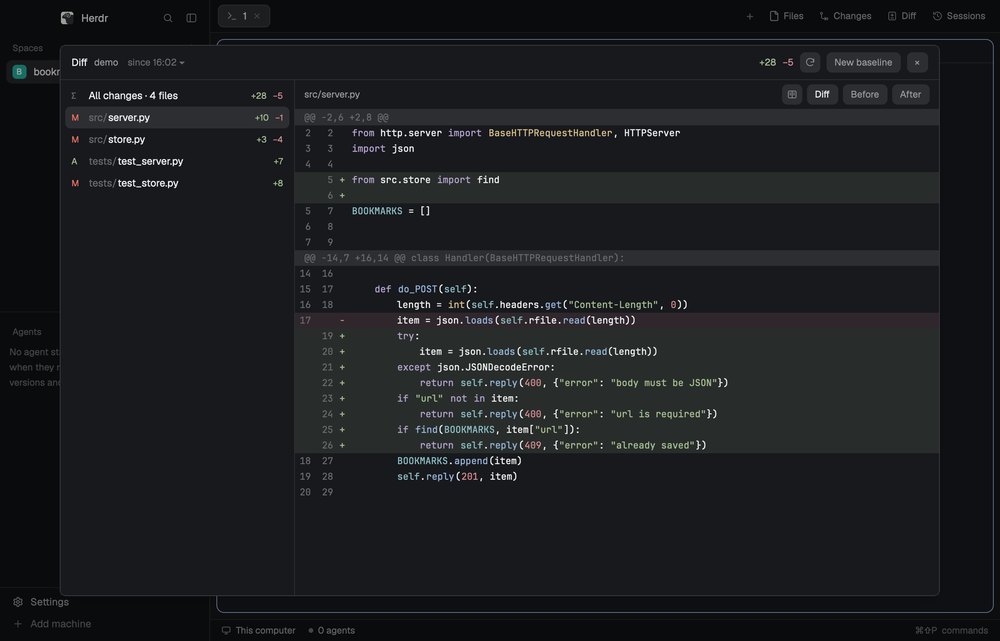

# Diff

Diff shows what changed in a folder since a baseline, for the folder of the focused terminal. It works whether or not
the folder is a git repo. The first time Diff sees a folder it saves a copy of its text files; from then on, every file
an agent or you add, delete or edit shows up as a list with +/− counts and a syntax-highlighted diff. You can view it
unified or side by side, or see the whole file as it was before or is now. A folder keeps a history of baselines, and
you can compare with any of them. Diff opens either as a side panel next to the terminals (a **Diff** button in the tab
bar) or as a large dialog (`cmd-shift-g`).

## What you see

- **The Diff button**, in the tab bar after Files and Changes: a 26px pill with `diff.svg` (a page with a plus over a
  line) at 14px and "Diff". Like the shipped panel buttons, it's `selected` while its panel shows and `chrome`
  otherwise, with `foreground` or `muted` text.
- **The panel** fills the side panel column (368px by default, 280–900) as a card: 10px radius, 1px `border`,
  `background`, text 13px `foreground`. **The dialog** is the same view at 88% × 86% of the window, without the card
  border, with a × button.
- **The header**, 44px high, 14px side padding, 8px gaps, 1px `border` below. From left to right:
  - "Diff" in semibold.
  - The folder's last path component, 12px `muted`, truncated.
  - A history toggle, `since 16:02 ▾`, 12px `dim` (`foreground` while the history is open). It shows the date too
    when the baseline isn't from today, ` (older)` while comparing with an older baseline, and ` · N` when there are
    several.
  - A braille spinner (⠋⠙⠹⠸⠼⠴⠦⠧⠇⠏, 90ms a frame), 12px `dim`, while a comparison or baseline is running.
  - On the right, after a spacer: the total `+N` (`ansi2`) and `−N` (`ansi1`) at 12px.
  - A 26px square refresh button (7px radius, `raised`, `muted` icon, `refresh.svg` at 14px, tooltip "Compare with
    the baseline now").
  - **New baseline**, or **Take baseline** as a primary button (`solid` with `solid_foreground`) when there's none yet.
  - In the dialog only, a × button.
- Buttons are 26px tall, 10px side padding, 7px radius, 12px text, `raised` with `muted` text, and `hover` on hover.
  Active ones are `selected` with `foreground` text. A danger button is `ansi1` text on `ansi1` at alpha `33` (`4d` on
  hover).
- **The baseline history**, under the header while open. It's min(200, 36 + 32 × count) px high and scrolls, with 6px
  padding and a 1px `border` below. It starts with "Baselines: click one to compare with it" (11px `dim`), then the
  baselines newest first. Each row is 30px, 7px radius, and `selected` for the one compared with. It shows
  `Oct 29 23:17:05 · 12 min ago` (12px), or "Taking a baseline…" for one in progress, "newest" on the newest
  (11px `dim`), `N files` (11px `dim`), and a **Delete** button that turns into a red **Delete?**.
- **The file list**, 6px padding, scrolling:
  - With more than one change it starts with an "All changes · N files" row: `∑` (11px `dim`) and the totals, +
    (`ansi2`) and − (`ansi1`).
  - Then one 28px row per changed file, sorted by path case-insensitively, 7px radius, `selected` when open, `hover`
    on hover. Each row has a status letter in a 14px column at 11px: `A` (`ansi2`), `D` (`ansi1`) or `M`
    (`blocked`). Then the folder part of the path in `dim` and the file name (at most 260px, truncated, struck
    through when deleted). Then `bin` for binary files (11px `dim`), and `+N`/`−N` at 11px.
  - Under the list, "Showing N of M changed files" when there are more than are shown.
- **Narrow** (Diff under 760px wide, the usual side panel): the file list on top at min(220, 12 + 28 × rows) px with a
  `border` line below it, and the selected file's diff underneath. **Wide** (760px or more, the dialog or a widened
  panel): the list is a 300px column on the left with a `border` line on its right, and the diff fills the rest at
  full height.
- **The diff bar**, 38px high, 12px side padding, 1px `border` below:
  - The file's path, 12px `muted`, truncated, or "All changes · N files".
  - While text is selected: `N lines · ⌘C` or `N chars · ⌘C` (11px `dim`) and a **Copy** button.
  - In the Diff view, a 26px side-by-side toggle (`split.svg`, `selected` while on). Its tooltip is "Side by side:
    before and after", or "One column" while on.
  - **Diff**, **Before** and **After** buttons. These are left out for All changes.
- **The diff** is drawn in the terminal font (`settings().font_family`, else "JetBrains Mono") at 12px, 20px per row:
  - Hunk headers (`@@ …`) are `dim` on `raised`. Notes such as "\ Showing the first 3000 lines" are `dim`.
  - Added rows have `ansi2` at alpha `1f` behind them, removed rows `ansi1` at `1f`.
  - The line number column is 14px + digits × the font's column width, right-aligned with 8px right padding, in `dim`.
    There are two number columns (old and new) only when lines were both added and removed and the view is at least
    520px wide; otherwise one, so a new file reads 1, 2, 3.
  - Then a 16px sign column: `+` in `ansi2`, `−` in `ansi1`.
  - Then the code, highlighted: keywords `ansi5`, strings `ansi2`, comments `dim`, functions `ansi4`, types `ansi3`,
    numbers `ansi1`, constants `ansi6`.
  - In All changes, each file starts with a `surface` row with a `border` line on top, in semibold: the status letter,
    the path and its +/− counts.
  - Selected text has `selection` behind it. A selection that runs on to the next line also marks the line break with
    a block one column wide.
  - Scrollbars are 6px thumbs, 3px radius, in `border`, 2px in from the right and bottom edges, at least 24px long.
- **Side by side**: before on the left and after on the right, each half 50% of the view, with a 1px `border` line
  between them. In a hunk, the removed and added lines face each other, and unchanged lines show on both sides. A half
  with no line opposite is `border` at alpha `30`. Each half keeps its place; the code in both halves, with its line
  numbers, scrolls sideways together.
- **Before / After**: the whole file in a read-only editor at 12px, with the same syntax colors. Instead of the editor
  you may see "New file: there was nothing before", "Deleted since the baseline", "Cannot preview this file (too large
  or unreadable)" or "Binary file · no text preview".
- **Empty states**, centered in `dim` (`ansi1` for an error): "Focus a terminal to pick its folder", "Taking a
  baseline…", "No changes since 16:02", "No baseline yet: click Take baseline", or the error.
- **A note line** at the bottom, 11px `dim`, with 14px/6px padding and a `border` line above. For example: "Baseline
  saved: changes from now on show here.", "New baseline saved.", "Copied 3 lines as a patch", "Copied 12 characters",
  or why a baseline couldn't be taken.

## How it behaves

- **Which folder:** a `folder` (and `machine`) in props wins. Otherwise it's the focused terminal's folder (the pane's
  `cwd`, else the focused `cwd`, else the space's `folder`), on the space's machine, or on the machine in a floating
  terminal's `machine/tN` id. When a mod pane has focus, Diff keeps the folder it had. Changing folders starts that
  folder fresh.
- **First visit:** if the folder has no baseline, Diff takes one at once and says "Baseline saved: changes from now on
  show here."
- **Staying current:** a local folder is watched (`watchFolder`), and every change compares again. Another machine's
  folder is compared every 5 seconds. Local folders are also compared when 30 seconds have passed since the last time.
- **Opening a file:** the first changed file opens by itself. Clicking a row opens it, and clicking it again closes it.
  The diff comes from `git diff --no-index --no-color --no-ext-diff --no-textconv -U3` between the baseline's copy and
  the file, run on the folder's machine, or from `diff -u` when git fails. It shows at most 3000 lines. Lines longer
  than 2000 characters are cut with " …", and tabs show as four spaces. All changes covers the first 300 files and
  20000 lines.
- **New baseline** adds a baseline to the history and compares with it. It shows at once as the newest, with no
  changes, and closes the history.
- **The history**, from `since … ▾`: click a baseline to compare with it. Diff compares every baseline with the folder
  in one pass when the history opens, so switching between them is instant. **Delete** arms, and **Delete?**
  deletes, but only when clicked at least 500ms later, so a double-click doesn't count. Moving the pointer off the
  list disarms it. Deleting the baseline being compared with switches to the newest one left.
- **Selecting and copying:**
  - Drag to select, double-click for a word, triple-click for a line, shift-click to extend. Dragging within 20px of
    the top or bottom, or 24px of the sides, scrolls on.
  - The wheel scrolls, and shift+wheel scrolls sideways. Pressing within 12px of the right or bottom edge drags that
    scrollbar.
  - `cmd-c` copies the selected code without the +/− markers, with tabs as they are. `cmd-shift-c` copies whole lines
    with their markers, as a patch. `cmd-a` selects every row.
  - Side by side, a selection stays on the side where it started, and select-all takes the right side.
- **Keys while Diff has the keyboard,** without cmd or ctrl: `s` toggles side by side; `Esc` clears the selection,
  then closes the dialog; PageUp, PageDown, Home and End scroll; `↓` or `j` opens the next file and `↑` or `k` the
  previous one; `d`, `b` and `a` switch to Diff, Before and After.
- **The dialog** takes the keyboard 50ms after it opens. × or `Esc` closes it, and so does `cmd-shift-g` again (`mod.open`
  toggles).
- The side-by-side choice is kept in `localStorage` (`split`). The side panel copy and the dialog copy each keep their
  own selection and file.

## Built from

- **Mod** `mods/session-diff/`:
  - `mod.json`: `{ "place": "none", "title": "Diff", "overlay": { "kind": "dialog", "width": 0.88, "height": 0.86 } }`.
  - `main.js`: the view, class `SessionDiff extends View`. Imports `View`, `div` and `svg` from `gpui-kit`; `v_flex`,
    `h_flex`, `Editor` and `EditorState` from `gpui-base`.
  - `highlight.js`: a small line-by-line highlighter for diff rows. File families (slash comments, `#` comments,
    key/value, `--` comments, markup, CSS, JSON) are picked by extension. It carries an unfinished block comment or
    triple-quoted string over to the next line.
  - `snapshot.sh`: all the baseline work, as a POSIX sh script.
  - `baseline.py`: the fast path for that work.
  - `diff.svg`, `refresh.svg` and `split.svg`: 24×24 stroke icons with `currentColor`.
  - `install.py`: see below.
- **herdr**: `spaces`, `panes`, `focused` (the folder); `exec(…, { on })` and `readTextFile(…, { on })` (on the
  folder's machine); `watchFolder`; `theme`; `settings` (`zoom`, `font_family`); `props` (`panel`, `overlay`,
  `folder`, `machine`); `closeOverlay`; `appHome`; `nextCommand`. Also `localStorage`, `cx.write_to_clipboard`,
  `cx.focus_handle`, `cx.timer` and `cx.spawn`.
- **Commands** via `nextCommand()` (`session-diff.<name>` in keys.json): `next`, `prev`, `diff`, `before`, `after`,
  `baseline`, `all`, `split`, `copy`, `copy-patch`, `history`, `everything` (All changes), `older`, `newer`.
- **keys.json**: `global` gets `cmd-shift-g` → `mod.open:session-diff`. `mod:session-diff` gets `cmd-c` →
  `session-diff.copy`, `cmd-shift-c` → `session-diff.copy-patch` and `cmd-a` → `session-diff.all`. On Linux,
  `install.py` writes `ctrl` for `cmd`.
- **Baselines** (`snapshot.sh` and `baseline.py`):
  - `main.js` reads both files from the mod folder. It runs `sh -c <snapshot.sh> session-diff <folder> <action> <id>
    <baseline.py code>` through `exec(…, { on: machine })`, so nothing has to be installed on another machine.
    Actions: `status`, `snapshot`, `delete`, `drop`, `survey`, `patch`. The script prints tab-separated lines:
    `base`, `snap`, `id`, `taken`, `none`, `error`, `total`, `home`, `F`, then `A|D|M <added> <deleted> <path>`.
  - They live on the folder's machine in `$HOME/.cache/herdr-session-diff/<cksum of the path>/<epoch id>/`. Each holds
    `tree/` (the copies), `list` (text files), `meta`, `count`, `taken`, `stamp`, `changes`, `numstat` and `result`.
    Each folder's directory also gets `folder` and a `used` marker.
  - Which files: regular files under 1 MiB. It prunes `.git .hg .svn node_modules .venv venv env __pycache__ .gradle
    .idea build target dist .next .cache .DS_Store .brazil .bemol cdk.out .terraform .tox .mypy_cache .pytest_cache
    .ruff_cache`. **Only text files are kept**: a NUL in the first 8 KiB makes a file binary, and empty files count as
    text. New or changed binaries never show.
  - Copies are copy-on-write clones, which cost about no disk: `clonefile` on macOS (APFS), the `FICLONE` ioctl or
    `cp --reflink` on Linux, and a real copy only where the disk can't clone.
  - With `python3` (run as `python3 -I -c <code>`), each file gets a stat key, `size:mtime_ns:ctime_ns:ino`, and the
    `meta` manifest records it with the file's kind. A new baseline clones the previous one's whole tree
    (`clonefile` on the folder, or `cp -a --reflink=auto`), then replaces only the files whose key changed. Files are
    sniffed and cloned 8 at a time.
  - `status` compares keys; only text files whose key changed get a full `filecmp`. Counts come from `git diff
    --no-index --numstat` and are cached in `numstat` by path and key. Results are ordered A, D, M, and the first 1000
    get counts.
  - `survey` lists the folder once and compares it with every baseline.
  - Without `python3`, the same is done in sh: `grep -I`, `cp --reflink=auto --parents`, or `cp -c` in batches of
    200, `comm`, and `cmp` on files newer than `stamp`.
  - A deleted baseline is renamed to `.gone-<id>-<pid>` at once and removed in the background.
- **Tab-bar button and side panel: `install.py`**, the same file in this mod and in the companion `sessions` mod.
  Herdr's `tabs` mod and `main` layout are read-only, so it makes copies from the installed Herdr version:
  - `mods/my-tabs`: a copy of `tabs`. Its `enabled` panel list gets `"session-diff"` appended, and a
    `panelButton("session-diff", "Diff", "mods/session-diff/diff.svg")` goes after the Changes button. It also gets
    a `resync(cx)` called from `init`, which compares `updates().app.version` with `cloned_from.version` in its
    `mod.json`. After a Herdr update, it re-runs `mods/sessions/install.py` or `mods/session-diff/install.py`,
    whichever exists, and shows a warning toast if that fails.
  - `layouts/my-herdr.json`: a copy of `main`, with its `tabs` block switched to `my-tabs` and a block
    `{ "id": "session-diff", "type": "block", "content": { "mod": "session-diff", "props": { "panel": true } } }`
    added to the `panel-body` stack.
  - It merges the keys above into `keys.json`, each only if the key is free.
  - It adds only the mods that are in `mods/` (Diff, Sessions or both). It runs `herdr-app check` on the new
    `my-tabs` before swapping it in, and switches to `my-herdr` the first time. If the new tab bar doesn't fit its
    edits, it writes nothing and exits 1.
  - **Installing agent:** after copying `mods/session-diff/` and merging `keys.json`, run
    `python3 ~/.config/herdr-app/mods/session-diff/install.py`. Without it, Diff works only as the dialog.

## Watch out

- **Each baseline is a copy, not a shadow git repo:** a shadow repo would turn the `.git` folders of nested repos into
  gitlinks and lose their contents.
- **The 30 s limit:** `hc exec` stops a command after 30 seconds. That's why the file walk prunes dependency,
  environment and build folders: a workspace's `env/` alone can hold hundreds of thousands of files. It's also why
  `python3` does the per-file work. The pruning matches folder names anywhere, so a real source folder called `build`,
  `env` or `dist` is skipped too.
- **Limits:** a baseline is refused, with a message, over 20,000 text files, or over 100,000 files listed. The 50 MB
  cap applies only when files must really be copied because the disk can't clone them. Your home folder and `/` are
  refused. Diffs show at most 3000 lines, and All changes at most 300 files and 20000 lines. Counts are shown for at
  most 1000 changes.
- **Pruning:** a folder's baselines go once nobody has compared with them for 30 days. The check runs whenever a
  baseline is taken. Single baselines are never pruned by age.
- **macOS python:** `/usr/bin/python3` without the Command Line Tools opens an install prompt, so the script uses
  `python3` there only if `xcode-select -p` succeeds. Otherwise it falls back to sh.
- **Wide layout:** at 760px or more the list and the diff sit in an `h_flex`, which centers its children vertically.
  The diff column needs `.h_full()`, or it collapses to zero height.
- **Side by side** draws each half at 50%, with the code shifted by the shared sideways offset (`relative().left()`)
  inside an `overflow_hidden` half. The scroll range is `scrollW()`: the view width plus how far the longest line runs
  past a half. Sizing each half to the longest line instead pushes the right half (the new code) off-screen.
- **gpui-kit gotchas:**
  - Handlers throw in `v_virtual_list` row renderers, and the rows go blank with nothing logged. So the diff draws
    only the visible rows itself, in a `relative().overflow_hidden()` view, with pointer maths on the font's column
    width. That width is measured from a hidden run of 100 zeros.
  - `herdr-app check` panics on a virtual list that has rows. Verify with `herdr-app shot`.
  - The mod runtime's root blurs focus on any mouse-down that reaches it and binds `cmd-c` to its own copy.
    `cx.stop_propagation()` in the diff's mouse-down handler keeps the keyboard, and mouse-up focuses again.
  - Herdr's keymap reload clears every binding, so `cx.bind_keys` doesn't last. Put keys in `keys.json` under
    `mod:session-diff`; they arrive through `nextCommand()`.
  - Theme colors can already be `#rrggbbaa`, and appending an alpha to those breaks the render. Use the `alpha()`
    helper, which keeps `#rrggbb` (or expands `#rgb`) and appends the new alpha.
- `snapshot.sh` and `baseline.py` are read once per mod load. Saving any file in the folder reloads the mod.
- **Two keyboard shortcuts need care:** `cmd-a` and `cmd-c` are bound only in the `mod:session-diff` section, so they
  act only while Diff has the keyboard. `cmd-shift-g` is global.

## Done when

- `herdr-app check ~/.config/herdr-app/mods/session-diff` passes, and so does `check` on `mods/my-tabs` after
  `install.py` runs.
- The tab bar shows Files, Changes and Diff. Diff opens and closes the side panel, and switching spaces restores each
  space's panel.
- In a terminal in a folder that isn't a git repo, the panel says "Baseline saved". `echo hi > new.txt` then shows
  `A new.txt +1` within a few seconds, and editing a file shows it as `M` with its +/− counts.
- Clicking a file shows a highlighted diff. **Before** and **After** show the whole file. The side-by-side toggle
  shows before on the left and after on the right, both visible at once, and scrolling sideways moves both.
- `cmd-shift-g` opens the dialog with the list on the left. `Esc` or × closes it.
- **New baseline** clears the list. `since … ▾` lists two baselines, clicking the older one shows the earlier changes
  again, and Delete, then Delete?, removes one.
- Dragging over code and pressing `cmd-c` puts that text on the clipboard. `cmd-shift-c` copies it with its markers.
- A new binary file (`head -c 100 /dev/urandom > x.bin`) never shows up.
