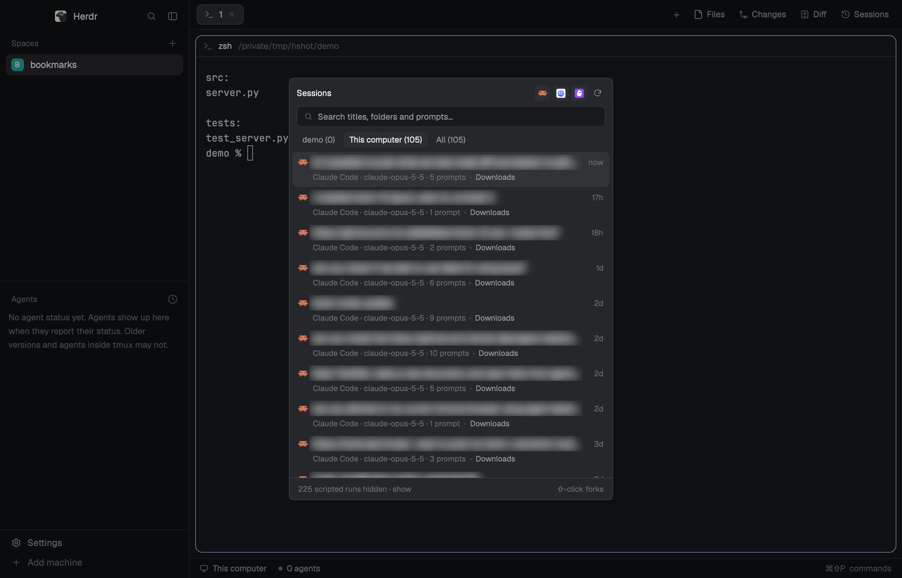

# Sessions

A list of your saved coding-agent sessions (Claude Code, Codex and Kiro), newest first. It covers this computer and every connected machine, and you can narrow it to the shown space's repository, its machine, or everything. Type to search titles, folders and every prompt you typed. Click a session to resume it in a new tab, in the folder it worked in on its machine; shift-click forks it. Hover a row for a trash button that deletes the session, after asking. It's in the side panel next to Files and Changes, and `cmd-shift-s` opens it as a popup.

## What you see

- **The Sessions button**, at the right end of the tab bar after Changes (and after Diff, if that mod is installed). It's a 26px pill with a clock-with-arrow icon (`sessions.svg`, 14px) and "Sessions", `selected` while its panel shows and `chrome` otherwise, like the tab bar's own panel buttons.
- **Where it shows:**
  - In the side panel column (368px by default, 280–900): the mod fills it on `chrome`.
  - As a popup (`mod.open sessions`, `cmd-shift-s`): 460×600 on `popover`, with the search field focused.
- **The header** (10px padding, 6px at the bottom, 7px gaps):
  - A row: "Sessions" (12px, semibold, `foreground`), then one 22px toggle per agent (Claude Code, Codex, Kiro), then a 22px refresh button. A toggle is the agent's 13px full-color icon (Herdr's `icons/claude.svg`, `icons/codex.svg`, `icons/kiro.svg`) on a `raised` square while shown, and the icon at 30% opacity with no square while hidden. The refresh button is `refresh.svg` 13px `muted`; while any machine is loading, it's the shipped `mods/workspace-chrome/spinner.svg` at 12px in `working`, spinning every 900 ms.
  - A 30px search field: 7px radius, 1px `border`, `background`. Shipped `mods/workspace-chrome/search.svg` at 13px in `dim`, then the input (12px) with the placeholder "Search titles, folders and prompts…".
  - Three scope chips (22px, 8px padding, 6px radius, 11.5px), the chosen one `foreground` on `raised` and the others `muted`:
    - the repository's folder name, or "This space", with its count
    - the shown space's machine name, or "This computer", with its count
    - "All" with its count
- **Notes**, one per machine, below the header (11.5px, 12px by 6px padding):
  - "Reading <machine>'s sessions…" before the first list arrives
  - "Still reading <machine>'s history (first run)…" while a first scan is partial
  - "<machine>: <error>" in `blocked`
- **The list**, scrolling, 4px side padding. Each row is 8px by 5px padding with a 7px radius, on `hover` while hovered, selected or asking:
  - Line 1:
    - the agent's 14px icon
    - the title in `foreground`, truncated
    - "open" (10.5px, `accent`) when a live terminal runs it
    - the age at 11px in `dim`: "now", "5m", "3h", "2d", or "4mo" past 60 days
    - on hover, the age gives way to an 18px trash button: `trash.svg` 12px, `dim`, turning `blocked` on `raised` under the pointer
  - Line 2, indented 21px, 11px `dim`: "Claude Code · claude-opus-4-1 · 5 prompts". Then " · " and, `muted` and at most 150px wide:
    - outside the space scope, the folder's name
    - in "All", also the machine
- **Asking to delete** replaces line 2 with a reason and the buttons:
  - The reason, truncated:
    - "Delete for good?" (with " on <machine>" for a remote one), `muted`
    - "Active 4m ago; an agent may still be running it." when it changed in the last 10 minutes
    - "It's open in a tab; close it there first." in `blocked`, with no Delete button
    - the error from a failed delete, in `blocked`
  - Then "Delete" (`blocked`) and "Cancel" (`muted`), 20px buttons at 11px.
  - While the delete runs, the row shows a spinner and "Deleting…".
- **"Show 50 more · 120 left"**: a 28px bordered button under the first 50 rows. Each press adds 50 more.
- **When nothing matches**, one line: "No sessions match “query”.", "No sessions in <folder> yet." or "No sessions yet.". When agents are hidden it adds "Kiro is hidden; click its icon above to show it."
- **The footer**: a 1px `border` line on top, 11px `dim`, `foreground` on hover. On the left, "225 scripted runs hidden · show" or "Showing scripted runs · hide"; on the right, "⇧-click forks".

## How it behaves

- **Machines:** this computer, plus every machine from `hc machine ls --json` that is `connected` and not `temporary`. Each one lists its own sessions with `scan.py`, which runs there through `exec("python3", ["-c", <scan.py's code>, …], {on})`. Nothing is installed on the remote side.
- **Scopes:**
  - **Space:** sessions whose folder is inside the shown space's repository. The space's folder is its first terminal's live `cwd`, else the folder it was made in. That folder is resolved once per machine and folder with `git rev-parse --show-toplevel`, else `pwd -P`.
  - **Machine:** every session on the shown space's machine.
  - **All:** every machine.
  - The chosen scope, the hidden agents and the scripted toggle are kept in `localStorage`.
- **Sources** (all newest first):
  - **Claude Code:** `~/.claude/projects/*/<id>.jsonl`.
    - Only `user`, `custom-title`, `ai-title` and `summary` lines are read.
    - User lines that are tool results, `isMeta` or `isSidechain` are skipped. `<system-reminder>…</system-reminder>` blocks are stripped. Text starting with `<` (slash commands, shell escapes) or `[Request interrupted` isn't a prompt.
    - The title is the custom title, else the AI title, else the summary, else the first prompt.
    - The model comes from the last `assistant` lines read, stepping past `<synthetic>`, up to 20 of them. The time is the last `timestamp`.
    - Sessions with no prompts, or whose `entrypoint` starts with `sdk`, are left out.
  - **Codex:**
    - Sessions come from the `threads` table of the newest `~/.codex/state_<n>.sqlite`, opened read-only: `archived = 0` and `source` in `cli`, `vscode`.
    - It reads `id`, `cwd`, `title`, `first_user_message`, `model`, `updated_at`/`updated_at_ms` and `git_branch`, whichever exist.
    - The title is used only when it differs from the first message.
    - Prompt counts and search text come from `~/.codex/history.jsonl` (`session_id`, `text`).
  - **Kiro v3:**
    - Each session is `~/.kiro/sessions/<folder hash>/sess_*/` holding `session.json` and `messages.jsonl`.
    - Prompts are the `"type":"user"` payloads. The title "New Session" counts as none.
    - The model is `session_state.rts_model_state.model_info.model_id`, else `modelId`.
  - **Kiro v2:**
    - Each session is `~/.kiro/sessions/cli/<id>.json` with `<id>.jsonl`.
    - Prompts are the `"kind":"Prompt"` lines.
  - Every folder is recorded with symlinks resolved (`realpath`), the same way the space's folder is resolved.
- **Scripted runs** (automated or cron agent runs) are marked and hidden unless the footer is clicked. A run counts as scripted when:
  - its folder is empty, `/`, or under `/tmp`, `/private/tmp`, `/var/folders/` or `/private/var/folders/`
  - or its first prompt starts with `[AGENT SYSTEM PROMPT]`, `[Previous chat history`, `<!--`, `<context_entry>`, "You are a " or "You are an "
  - Scripted rows are sent only when asked for (`list --scripted`). The footer always counts them.
- **Refreshing:**
  - It refreshes when it starts.
  - It refreshes every 60 seconds, but only while it's on screen: a popup always, a side panel only while the panel shows and its stack shows `sessions`.
  - It refreshes when it comes back into view after more than 15 seconds.
  - It refreshes when you click refresh.
  - Each list call sends the last `sig` (an md5 of the rows). A machine with nothing new answers `{"same": true}` instead of the rows.
- **Searching:**
  - Typing filters the loaded rows at once. A row must hold every word in its title, first or last prompt, folder, model, branch, id, agent name or machine.
  - After 250 ms of no typing, every machine also runs `scan.py search <words…>` over each session's saved prompts (up to 300 hits). The hits are merged in.
- **Opening:** clicking a row, Enter in the search field, or the `open`/`fork` commands.
  - **Resume:**
    - `claude --resume <id>`
    - `codex resume <id>`
    - `kiro-cli chat --agent-engine <v3|v2> --resume-id <id>`
  - **Fork (shift-click):**
    - `claude --resume <id> --fork-session`
    - `codex fork <id>`
    - Kiro has no fork, so shift-click resumes it.
  - If a live terminal already runs that session (its id is in the terminal's argv), a plain click focuses it with `pane.focus` instead.
  - Otherwise, a new tab named by the first 28 characters of the title, in this order:
    - the shown space, if it's on the session's machine
    - else a space on that machine whose folder holds the session's folder
    - else the first space there
    - else a new space (`space.new` with `machine`, `folder`, `tab`, `argv`)
  - The folder is used only when `test -d` finds it on that machine. A popup then closes.
- **Deleting:**
  - The trash button asks; Delete deletes, Cancel or Escape stops asking.
  - The `delete` command asks the first time and deletes the second.
  - A session open in a live terminal isn't deleted.
  - `scan.py delete <agent> <id> <engine> <cwd>` runs on the session's machine. It first checks that the id looks like a session id: hex with dashes, optionally after `sess_`.
  - **Codex:** `codex delete --force <id>`, run in the session's folder (or home).
  - **Kiro:** `kiro-cli chat --agent-engine v3|v2 --delete-session <id>`. Afterwards it checks that the files are gone and reports "kiro-cli didn't delete it" if they aren't.
  - **Claude Code:** there's no command, so it removes:
    - `projects/*/<id>.jsonl` and `projects/*/<id>/`
    - `file-history/<id>`, `session-env/<id>` and `tasks/<id>`
    - `todos/<id>-*`
  - On success the row leaves the list at once. On failure the error shows in the row.
- **Keys:**
  - Up and Down move the selection. Moving past the drawn rows draws 50 more.
  - Escape stops asking, else it closes the popup.
  - Commands (for `keys.json` or `herdr-app do`): `sessions.next`, `prev`, `open`, `fork`, `delete`, `more`, `refresh`, `space`, `machine`, `all`, `scripted`.

## Built from

- **Mod** `mods/sessions/`:
  - `main.js` is the view, for both the panel and the popup.
  - `scan.py` is the scanner.
  - `mod.json`: `{ "place": "none", "title": "Sessions", "overlay": { "width": 460, "height": 600 } }`.
  - Icons: `sessions.svg`, `refresh.svg` and `trash.svg`, 24-unit stroke icons drawn in `currentColor`.
  - It also uses Herdr's own `icons/claude.svg`, `icons/codex.svg` and `icons/kiro.svg` (with `image()`), and the shipped `mods/workspace-chrome/spinner.svg` and `search.svg`.
- **keys.json:** `{ "global": { "cmd-shift-s": "mod.open:sessions" } }`. Use `ctrl-shift-s` off macOS.
- **The tab-bar button and the side-panel block come from `install.py`**, the same file that ships in `mods/session-diff/`. Herdr's `tabs` mod and `main` layout are read-only, so it builds copies from the installed version:
  - `mods/my-tabs`:
    - The shipped `tabs` with `mods/tabs/` paths renamed.
    - `enabled` extended with the installed panel mods.
    - A `panelButton("sessions", "Sessions", "mods/sessions/sessions.svg")` after the Changes line.
    - The `herdr` imports it needs, and a `resync(cx)` called first in `init`. On the first start of a different Herdr version (`updates().app.version` against `cloned_from.version` in its `mod.json`), it re-runs whichever `install.py` exists, and warns with a toast if that fails.
  - `layouts/my-herdr.json`: the shipped `main` with its `tabs` block on `my-tabs`, and a `{ "id": "sessions", "type": "block", "content": { "mod": "sessions" } }` child added to the `panel-body` stack.
  - It merges its keys into `keys.json` only where the key is free.
  - It adds only the panel mods that are present: Diff, Sessions or both.
  - It runs `herdr-app check` on the new `my-tabs` before swapping it in.
  - On the first install it runs `layout.switch {"name": "my-herdr"}`.
  - If the shipped tab bar or layout no longer fits these edits, it changes nothing, prints "Nothing changed: …" and exits 1.
  - **After copying the folder, run `python3 ~/.config/herdr-app/mods/sessions/install.py`.** Run it again after adding Diff.
- **herdr:**
  - functions: `exec`, `hc`, `spaces`, `panes`, `terminals`, `run`, `theme`, `appHome`, `readTextFile`, `props` (`overlay`), `closeOverlay`, `nextCommand`, `layout`, and `localStorage`
  - commands it runs: `pane.focus`, `space.select`, `tab.new`, `space.new`
- **gpui-base:** `InputState` / `Input`, `v_flex`, `h_flex`.
- **gpui-kit:** `View`, `div`, `svg`, `image`.
- **scan.py:**
  - It runs with Python 3.9 or newer, standard library only (`json`, `mmap`, `re`, `sqlite3`, `subprocess`, …), on whatever `python3` each machine has.
  - Actions: `list [--scripted] [--since <sig>]`, `search <words…>`, `delete <agent> <id> <engine> <cwd>`. Each prints one JSON document.
  - **The cache** is `~/.cache/herdr-sessions/` on each machine:
    - `index.json`, tagged with `VERSION` (4), holds, per transcript, its inode and device, how far it was read (`off`), its mtime and what it held.
    - A changed inode, or a file that shrank, is read again from the start. Deleted files drop out with their text.
    - Kiro's `session.json` is parsed again only when its mtime or size changes.
    - `text/<agent>_<id>.txt` keeps each session's prompts for search: up to 1,000 characters per prompt (`PROMPT_CAP`) and 8,000 per session.
  - **Reading:** only the bytes appended since the last run are read. The file is mapped (`mmap`), and a bytes regex finds just the marker lines. Kiro prompts are read in place from the start of the JSON string, capped at `PROMPT_CAP`, without parsing the whole line.
  - **Limits:** rows carry 200 characters of the first and last prompt; `list` returns at most 5,000 rows.

## Watch out

- `hc exec` stops a command after 30 seconds, and a first scan of a big history can take longer. `scan.py` stops reading after 12 seconds (`BUDGET`), saves how far it got and returns `"partial": true`. The panel runs it again 200 ms later until it's complete, and `same` is never sent while partial.
- Keep `scan.py` Python 3.9-compatible: some Linux machines' system `python3` is 3.9. No `match`, no `X | Y` types, no 3.10+ library calls.
- `closeOverlay` ends the copy and every task it started. In the popup, run `tab.new` (or `space.new`) first and close it last.
- `do sessions.<command>` reaches a copy only while it waits in `nextCommand()`, and only shown copies.
- Saving any file in `mods/sessions/` reloads the mod, `scan.py` included. `scan.py` is read once per copy and cached.
- Tinting a full-color icon with `svg()` gives a solid square. Draw the agent icons with `image()` and fade them with `.opacity()`.
- `kiro-cli … --delete-session` prints "Deleted" even for an unknown id, so check that the files are gone afterwards.
- Claude Code has no per-session delete command (`claude purge` works per project), so deleting removes its files directly.
- "Open in a tab" is detected only when the session id appears in a live terminal's argv, as it does for tabs this mod opened. A session started fresh with `claude` and still running isn't detected. For a session that changed in the last 10 minutes, the only protection is the warning.
- Clicks and presses stop propagation (`cx.stop_propagation()` on mouse-down), or the mod runtime blurs the search field. A row ignores a click within 400 ms of a press on its own trash, Delete or Cancel button.
- Bump `VERSION` in `scan.py` whenever the fields it saves per file change, or old cache entries will lack them.

## Done when

- `herdr-app check ~/.config/herdr-app/mods/sessions` passes, and so does `herdr-app check ~/.config/herdr-app/mods/my-tabs` after `install.py`.
- The tab bar shows Files, Changes and Sessions. Sessions opens and closes the side panel, and `cmd-shift-s` opens and closes the popup.
- With Claude Code, Codex or Kiro history on this computer, "This computer" lists it newest first, with agent, model and prompt count. A connected remote machine's sessions appear under "All", tagged with its name.
- The space chip lists only sessions inside the shown space's repository.
- Typing a word that appears only in an old prompt finds that session within about a second.
- Clicking a row opens a new tab running `claude --resume <id>` (or the Codex/Kiro equivalent) in its folder. Shift-click on a Claude Code row runs it with `--fork-session`.
- The trash button on a throwaway session asks "Delete for good?". Delete removes the row, and a refresh doesn't bring it back.
- Clicking the footer shows the scripted runs and changes its text to "Showing scripted runs · hide".
- A second `python3 -c "$(cat scan.py)" list` on the same machine runs in well under a second.
